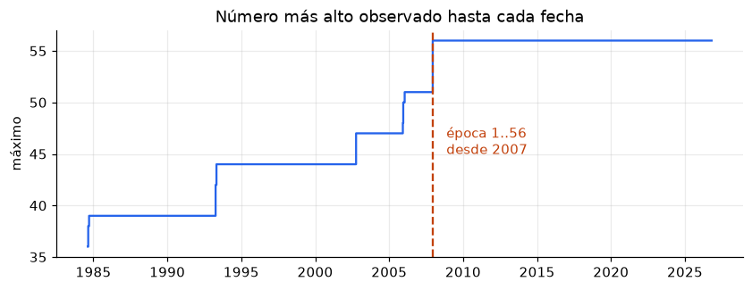
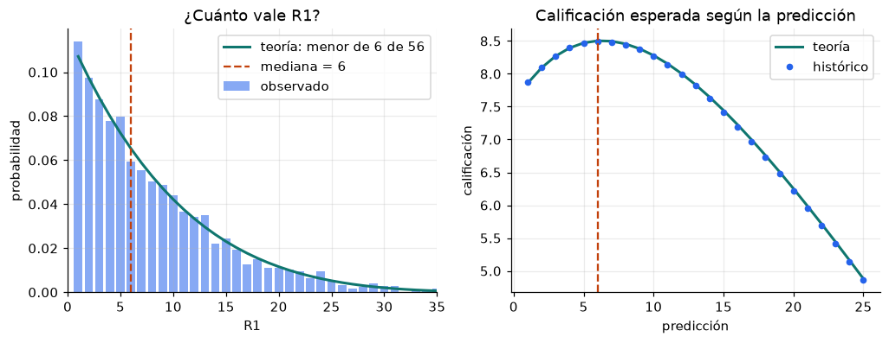
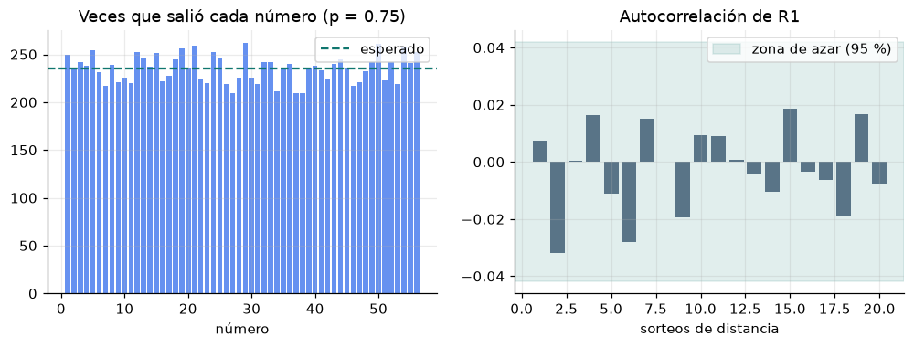
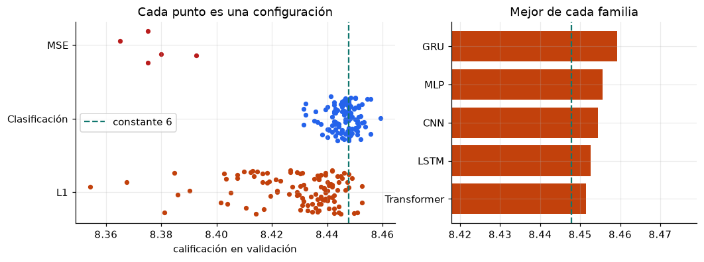
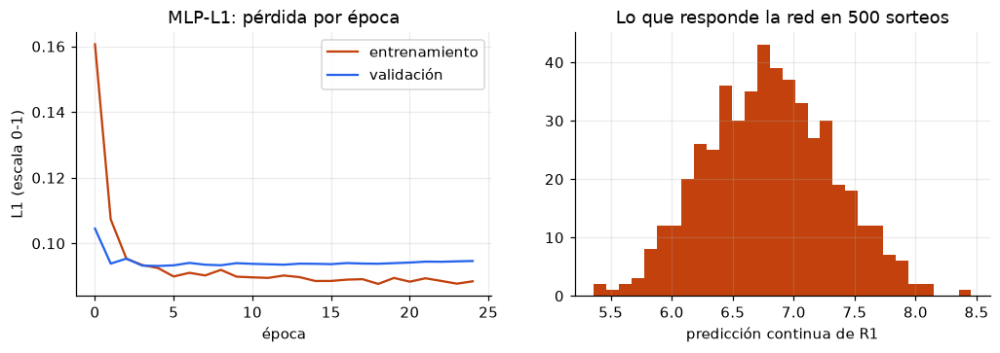
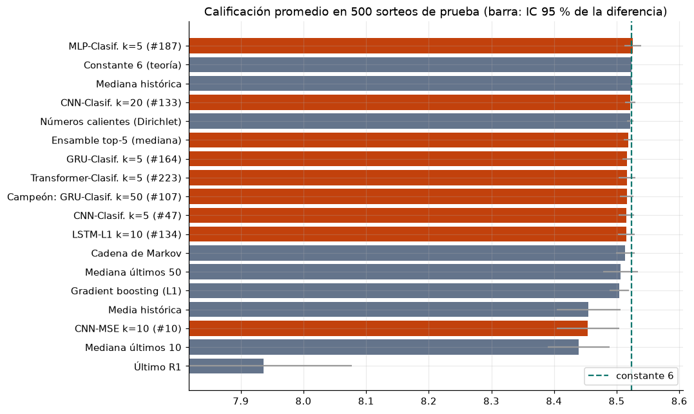
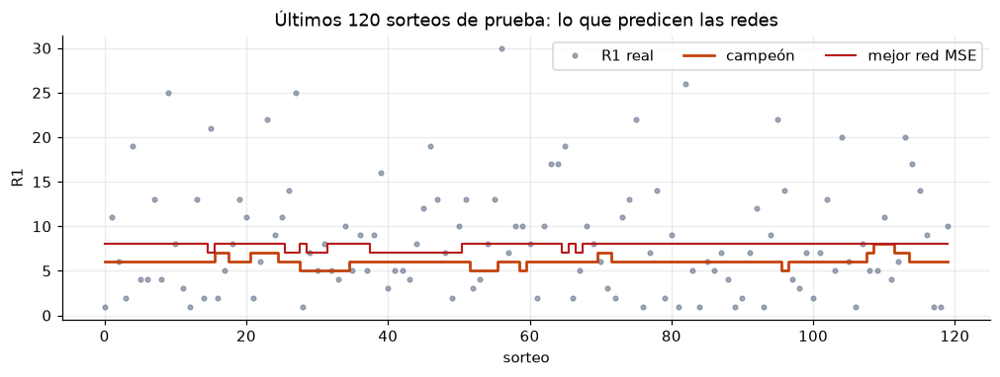
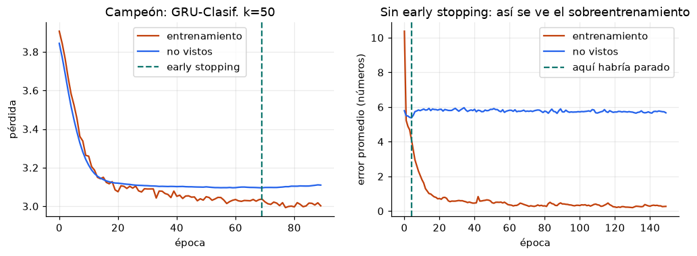
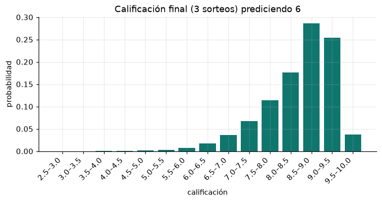

# Predicción de R1 del Melate: resumen de resultados

Generado 2026-10-22 09:07. Datos: descarga previa (2 sorteos nuevos); 4281 sorteos (1984-08-19 a 2026-10-21).

## Predicción para los sorteos del 23, 25 y 28 de octubre

# R1 = 6

- Método: Constante 6 (mediana teórica). Motivo: el campeón de Deep Learning no le ganó a la constante en la prueba final.
- El campeón de Deep Learning predice 6.
- 8 de 11 métodos dan el mismo número.
- Calificación esperada por sorteo: 8.50.

## 1. Los datos

- R1..R6 se publican **ordenados**: R1 es el menor de los seis números, no la primera bola que sale.
- El universo de números cambió 9 veces desde 1984. La época actual (1..56) empieza en el
  concurso 2089 (2007-12-12) y tiene 2193 sorteos; solo se usa esa época.
- Validaciones superadas: producto unico, concursos consecutivos, concurso inicia en 1, fechas no decrecientes, r1 a r6 ordenados, r7 distinto de r1 r6.

## 2. La distribución de R1

- Teoría (el menor de 6 números de 56): mediana 6, media 8.14.
  Observado: mediana 6, media 8.10.
- Los datos se ajustan a la fórmula (chi-cuadrada p = 0.719).
- El examen castiga el error absoluto, así que la mejor constante es la mediana: **6**,
  con calificación esperada 8.503 por sorteo.

## 3. ¿Tiene memoria el sorteo?

| Prueba | Resultado | Lectura |
|---|---|---|
| Frecuencia de los 56 números | chi-cuadrada p = 0.749 | todas salen igual de seguido |
| Autocorrelación de R1, 20 rezagos | 0 fuera de la banda de 95 % | por azar se espera 1 |
| Ljung-Box | p = 0.773 (10), 0.978 (20) | sin memoria detectable |
| Rachas alto/bajo | z = -0.66, p = 0.512 | compatible con azar |
| R1 anterior vs siguiente | chi-cuadrada p = 0.771 | independientes |

Ninguna prueba encuentra memoria: el pasado no dice nada del siguiente R1.

## 4. Deep Learning: la búsqueda

240 configuraciones de 5 familias (MLP, LSTM, GRU, CNN, Transformer), 3 tipos de salida, ventanas de
5 a 50 sorteos, 3 formas de entrada y distintos hiperparámetros. Cada una se evaluó hacia adelante en la
validación (2019-05-15 a 2023-08-09), con 2 semillas
y reentrenando cada 250 sorteos.

- Constante 6 en validación: 8.448. Le ganaron 42
  de 240 configuraciones (mejor 8.459, peor 8.354).

| Familia | Configuraciones | Mejor | Mediana |
|---|---|---|---|
| CNN | 43 | 8.454 | 8.445 |
| GRU | 49 | 8.459 | 8.442 |
| LSTM | 48 | 8.453 | 8.447 |
| MLP | 60 | 8.456 | 8.437 |
| Transformer | 40 | 8.451 | 8.442 |

| Salida / pérdida | Configuraciones | Mejor | Mediana |
|---|---|---|---|
| Clasificación | 124 | 8.459 | 8.448 |
| L1 | 111 | 8.453 | 8.436 |
| MSE | 5 | 8.393 | 8.375 |

## 5. La prueba final

Los últimos 500 sorteos (2023-08-11 a 2026-10-18) no participaron en ninguna decisión. Se reentrena cada
100 sorteos con 3 semillas. La diferencia contra la constante
lleva un intervalo de confianza de 95 % por bootstrap pareado.

| Método | Tipo | Validación | Prueba | Dif. vs constante (IC 95 %) | Predicción más común |
|---|---|---|---|---|---|
| MLP-Clasif. k=5 (#187) | Deep Learning | 8.456 | 8.526 | +0.002 (-0.011 a +0.016) | 6 (73%) |
| Constante 6 (teoría) | Estadístico | 8.448 | 8.523 | +0.000 (+0.000 a +0.000) | 6 (100%) |
| Mediana histórica | Estadístico | 8.448 | 8.523 | +0.000 (+0.000 a +0.000) | 6 (100%) |
| CNN-Clasif. k=20 (#133) | Deep Learning | 8.454 | 8.522 | -0.002 (-0.010 a +0.006) | 6 (91%) |
| Números calientes (Dirichlet) | Estadístico | 8.438 | 8.522 | -0.002 (-0.007 a +0.004) | 6 (95%) |
| Ensamble top-5 (mediana) | Deep Learning | 8.459 | 8.519 | -0.005 (-0.012 a +0.002) | 6 (93%) |
| GRU-Clasif. k=5 (#164) | Deep Learning | 8.456 | 8.517 | -0.007 (-0.014 a +0.001) | 6 (92%) |
| Transformer-Clasif. k=5 (#223) | Deep Learning | 8.451 | 8.516 | -0.007 (-0.020 a +0.006) | 6 (74%) |
| Campeón: GRU-Clasif. k=50 (#107) | Deep Learning | 8.459 | 8.516 | -0.007 (-0.018 a +0.004) | 6 (86%) |
| CNN-Clasif. k=5 (#47) | Deep Learning | 8.454 | 8.516 | -0.008 (-0.020 a +0.005) | 6 (77%) |
| LSTM-L1 k=10 (#134) | Deep Learning | 8.453 | 8.516 | -0.008 (-0.021 a +0.005) | 6 (75%) |
| Cadena de Markov | Estadístico | 8.449 | 8.514 | -0.010 (-0.025 a +0.005) | 6 (68%) |
| Mediana últimos 50 | Estadístico | 8.424 | 8.506 | -0.017 (-0.045 a +0.011) | 6 (38%) |
| Gradient boosting (L1) | ML clásico | 8.451 | 8.504 | -0.019 (-0.035 a -0.004) | 6 (67%) |
| Media histórica | Estadístico | 8.401 | 8.455 | -0.068 (-0.119 a -0.017) | 8 (100%) |
| CNN-MSE k=10 (#10) | Deep Learning | 8.393 | 8.454 | -0.070 (-0.119 a -0.019) | 8 (84%) |
| Mediana últimos 10 | Estadístico | 8.338 | 8.439 | -0.084 (-0.133 a -0.034) | 6 (20%) |
| Último R1 | Estadístico | 7.797 | 7.937 | -0.587 (-0.733 a -0.446) | 1 (12%) |

**Campeón (Campeón: GRU-Clasif. k=50 (#107)):** 8.459 en validación y 8.516 en prueba. Diferencia contra la
constante: -0.007 (IC -0.018 a +0.004).
No le gana de forma significativa: lo que parecía ventaja en validación era suerte de la selección.

La búsqueda se amplió después de una primera corrida de 160 configuraciones, cuyo campeón (Ensamble top-5 (mediana)) quedó en -0.007 (IC -0.015 a +0.001). Cada corrida eligió su campeón solo con validación, pero la prueba final se usó una vez por corrida.

## 6. Por dentro de las redes, y ¿se sobreentrenaron?

Sobreentrenar es memorizar los sorteos de entrenamiento en vez de aprender: a la red le va mucho mejor con lo
que ya vio que con sorteos nuevos. Como los dos periodos no califican igual ni para "siempre 6"
(8.510 en entrenamiento, 8.451 en sorteos no vistos), cada red se mide
por su **ventaja sobre "siempre 6" dentro de cada periodo**.

| Red | Capas | Parámetros | Época elegida | Ventaja en entrenamiento | Ventaja en no vistos |
|---|---|---|---|---|---|
| ★ GRU-Clasif. k=50 | Entrada → GRU, capa 1 (16) → GRU, capa 2 (16) → Salida (51) | 6,339 | 70 de 90 | +0.022 | +0.004 |
| CNN-Clasif. k=20 | Entrada → Convolución 1 (128) → Convolución 2 (128) → Promedio (128) → Salida (51) | 58,291 | 23 de 43 | +0.001 | +0.003 |
| CNN-Clasif. k=5 | Entrada → Convolución 1 (64) → Convolución 2 (64) → Promedio (64) → Salida (51) | 27,635 | 5 de 25 | +0.018 | -0.001 |
| CNN-MSE k=10 | Entrada → Convolución 1 (32) → Convolución 2 (32) → Promedio (32) → Salida (1) | 3,745 | 39 de 59 | -0.062 | -0.053 |
| GRU-Clasif. k=5 | Entrada → GRU, capa 1 (32) → GRU, capa 2 (32) → Salida (51) | 17,235 | 29 de 49 | +0.008 | -0.002 |
| LSTM-L1 k=10 | Entrada → LSTM, capa 1 (128) → LSTM, capa 2 (128) → Salida (1) | 227,457 | 1 de 21 | -0.007 | -0.009 |
| MLP-Clasif. k=5 | Entrada → Capa densa 1 (32) → Capa densa 2 (32) → Salida (51) | 3,731 | 35 de 55 | -0.006 | +0.005 |
| Transformer-Clasif. k=5 | Entrada → Proyección (128) → Atención 1 (128) → Atención 2 (128) → Salida (51) | 279,475 | 4 de 24 | +0.002 | -0.032 |

La mayor ventaja en los sorteos de entrenamiento es +0.022 puntos por sorteo: las redes casi
no memorizaron (dropout y early stopping), y en sorteos nuevos quedan en cero porque no hay patrón que aprender.

Contraejemplo hecho a propósito: una red de 859,905 parámetros sin dropout ni early stopping, entrenada
150 épocas. Su error con los sorteos que ya vio baja de 10.4 a 0.27
números (los memorizó); con sorteos nuevos su mejor momento fue la época 5 (5.38) y
terminó en 5.67.

## 7. Tres sorteos, un número

Prediciendo 6: calificación esperada 8.50. P(9 o más) = 36%,
P(8 o más) = 78%, P(menos de 7) = 6%. El 80 % de las veces queda entre
7.3 y 9.4: la suerte pesa mucho más que la diferencia entre métodos.

